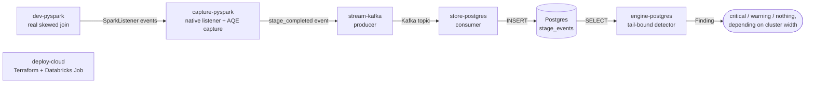

# Portfolio case: porting Apex to a Spark/Kafka/Postgres/AWS-Databricks stack

> **Fork of** [luanmorenommaciel/apex](https://github.com/luanmorenommaciel/apex) ·
> **branch** `portfolio/aws-databricks-stack` · built with Claude Code.
> Original project's own README is unchanged below this file — this document is the
> case for *this branch's* work, not a claim about the upstream project.

## The pitch

Apex is an open-source Spark performance tool whose entire thesis is refusing to report a
number it can't measure — a fixed-threshold skew rule gets rebuilt into a closed-form physics
bound, derived and tested against real measured runs, because a 21.6× ratio on a 2-slot
cluster and the same ratio on a 50-slot cluster mean opposite things. That discipline —
decoupled lanes, a frozen contract between them, deterministic logic before any LLM — is the
part worth demonstrating independently of the original stack.

This branch ports that architecture to **PySpark, Kafka, Postgres, Docker, and
Databricks/AWS** instead of Scala, OTel Collector, and ClickHouse. Six lanes, each a real
engineering decision with a stated trade-off, not a global search-and-replace:



## What was actually proven, not just built

The strongest claim a portfolio case can make is a command and its real output — from a
**real Spark job**, not a crafted event. `dev-pyspark/`'s 2M-row skewed join ran in a real
`apache/spark:4.0.1` container, AQE genuinely split one of its skewed partitions (task count
rose from 8 to 9), and the resulting row landed in Postgres through the real Kafka chain:

```sh
$ POSTGRES_DSN=... python engine-postgres/scripts/analyze_job.py local-1791941143879 --slots 8
```
```json
{"findings": [{"severity": "critical",
  "evidence": "p99/p50 = 5.11x on stage 4 ... > (n-1)/(slots-1) = (9-1)/(8-1) = 1.14 [operator]; an ideal rebalance could remove at most 78.0% of this stage's wall time",
  "details": {"tail_bound_margin": 4.47, "slots": 8}}]}
```
```sh
$ python engine-postgres/scripts/analyze_job.py local-1791941143879 --slots 2   # same stored row
```
```json
{"findings": []}
```

Same real job, same real stored row — critical at 8 slots, nothing at all at 2 slots, because
5.11× needs more than 8× to be tail-bound on a 2-slot cluster. That asymmetry is the entire
reason Apex's closed form exists instead of a fixed `5×`/`10×` rule, and reproducing it from
an actual Spark execution through a different stack — not a fixture — is the proof the
architecture's lane boundaries actually hold.

The same run also produced a genuine AQE decision, captured structurally (no literal data) by
`capture-pyspark/aqe.py`:

```json
{"execution_id": 0, "update_seq": 2, "transition_type": "skew_split",
 "detail": "SortMergeJoin(skew=true) -- AQEShuffleRead split a skewed partition",
 "before": "SortMergeJoin", "after": "SortMergeJoin(skew=true)", "confidence": "HIGH"}
```

## The six lanes

| Lane | Replaces | What it does | Tests |
|---|---|---|---|
| [`dev-pyspark/`](dev-pyspark/) | `dev/` (Delta/MinIO lab) | A real 2M-row skewed sort-merge join, no S3/Delta dependency — just enough to produce genuine skew. | — (generates data for the others) |
| [`capture-pyspark/`](capture-pyspark/) | `jar/` (Scala plugin) | Native `SparkListener` bridged through py4j — no JVM build step. Aggregates per-stage task-duration percentiles **in-process** (a 10k-task stage produces one Kafka message, not 10k) and captures real AQE plan transitions. | 39 |
| [`stream-kafka/`](stream-kafka/) | `collect/` (OTel Collector) | Kafka producer, routes by event type, degrades an unshaped payload to a minimal envelope instead of crashing. | 9 |
| [`store-postgres/`](store-postgres/) | `infra/` (ClickHouse) | DDL + idempotent Kafka consumer + a **verified-live Docker Compose stack**. | 13 unit + 1 live integration |
| [`engine-postgres/`](engine-postgres/) | `engine/` (detectors) | The tail-bound skew physics, ported near-verbatim, reading from Postgres. | 25 |
| [`deploy-cloud/`](deploy-cloud/) | — | Terraform (AWS: MSK + RDS) + a Databricks Job running `dev-pyspark/`'s script unmodified. **Written and locally validated, not applied** — see its README. | — (IaC, not app code) |

**86 unit tests, 0 requiring live infrastructure to pass**, plus one live integration test and
the real end-to-end Spark run described above. Every lane's own README documents what it
does, what it costs, and what's still missing — written as a decision record, not a
changelog.

## Real engineering judgment calls, each with a documented trade-off

A portfolio case built only from things that worked on the first try doesn't show much. These
didn't:

1. **Percentile aggregation moved into the capture layer, mid-build.** The original plan had
   a per-task Kafka topic. A 10k-task stage would mean 10k Kafka messages for a number the
   Spark driver can compute for free — reworked to aggregate in-process
   (`capture-pyspark/aggregator.py`) before any code shipped.
   ([stream-kafka/README.md](stream-kafka/README.md))

2. **Two silent Kafka failures, found running the real stack.** A consumer that subscribes
   before its topic exists can stay blind to it for 5 minutes after auto-create finally
   fires; `__consumer_offsets`'s default replication factor (3) is unsatisfiable on one
   broker, and every consumer group hangs forever with **no error message** — the first fix
   attempt made it worse. Root cause confirmed by reading broker logs, not guessed.
   ([store-postgres/docker-compose.yml](store-postgres/docker-compose.yml))

3. **py4j's callback server silently dropped every event on a real cluster.**
   `start_callback_server()` alone opens a socket the JVM was never told about — every
   callback failed with `Connection refused`, forever, and a whole 2M-row job produced
   `received=0`. Fixed with PySpark's own `ensure_callback_server_started`, the same helper
   `StreamingQueryListener` uses internally. Found running a real job, not writing the
   listener. ([capture-pyspark/README.md](capture-pyspark/README.md))

4. **AQE erased the skew before this port ever measured it — CONTRACT.md's rule 7,
   reproduced live.** The join's first version let AQE coalesce all 8 shuffle partitions into
   1 task, because so little data survived partial aggregation. The skew was real and gone by
   the time a listener could see it. ([dev-pyspark/README.md](dev-pyspark/README.md))

5. **A scope cut stated as a cut, not hidden as a feature.** `engine-postgres/`'s detector
   cannot detect join-vs-task skew (no captured query plan) and has no cross-run noise-floor
   history. The fix text explicitly says it will not recommend
   `spark.sql.adaptive.skewJoin.*` without plan evidence. Documented as missing *inputs*, not
   weaker *logic*. ([engine-postgres/README.md](engine-postgres/README.md))

6. **The cloud deployment stops at validated, not applied.** `deploy-cloud/`'s Terraform
   passed `terraform validate` against real AWS credentials this session had — and was
   deliberately never run through `plan` or `apply`. Provisioning MSK/RDS has real cost and
   wasn't the point being proven. ([deploy-cloud/README.md](deploy-cloud/README.md))

## Stack mapping

| Role | Upstream | This branch |
|---|---|---|
| Generate | PySpark + Delta/MinIO | PySpark, no Delta dependency |
| Capture | Scala, compiled JVM plugin | Python, PySpark, py4j |
| Transport | OpenTelemetry Collector | Kafka (KRaft, single-broker) |
| Store | ClickHouse + HyperDX | Postgres |
| Detection | Python (unchanged) | Python, same physics, Postgres reads |
| Local infra | Docker Compose | Docker Compose |
| Cloud target | — | Terraform (AWS: MSK + RDS) + Databricks Job — written, validated, not applied |

See [`docs/ADAPTATION.md`](docs/ADAPTATION.md) for the lane-by-lane rationale this table
summarizes.

## What's not done yet

- Plan-fingerprint extraction (the full logical-plan hash) — needs `QueryExecutionListener`,
  a separate registration point from the `SparkListener` this port already uses.
- `join_switch` and `coalesce` AQE transitions are implemented from upstream's documented
  conventions but not yet exercised by a real triggering run — only `skew_split` has been.
- An actual cloud deployment: `deploy-cloud/`'s IaC has never been applied against a live
  AWS account or submitted to a live Databricks workspace.

## Run it yourself

```sh
cd store-postgres && cp .env.example .env && docker compose up -d --wait   # kafka+postgres+consumer
cd ../dev-pyspark && docker compose build skew-join-job && docker compose run --rm skew-join-job
```

Runs a real skewed Spark job through the whole chain. Then point
`engine-postgres/scripts/analyze_job.py` at the `job_id` it prints (see
[`dev-pyspark/README.md`](dev-pyspark/README.md) for the exact commands). Each lane's own
README documents its unit tests (`python -m pytest`, no infra needed).
